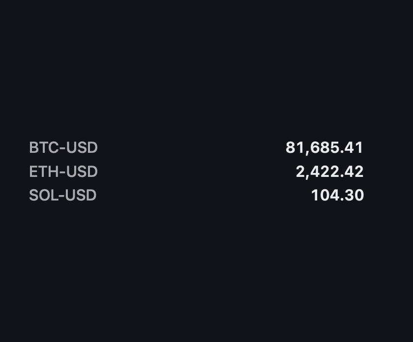

# Coin Ticker

Live cryptocurrency spot prices from Coinbase. It is the sample widget for EdgeHost's Rhai add-ins:
the widget only draws rows, while the [CoinPrices add-in](../../addins/dev.edgehost.coin-prices)
polls Coinbase every 30 seconds and signals each price change. A row shows ▲ or ▼ in the Rising or
Falling color after its price moves.



*Medium (M) slot, default pairs, first prices after start (no change arrows yet).*

## Requirements

- The CoinPrices add-in, installed: `edgectl addin install examples/addins/dev.edgehost.coin-prices`.
  The manifest asks for it as `edgehost.coinprices:CoinPrices:1.0`; the widget uses it as
  `window.plugins.Coinprices`.
- Network access to `api.coinbase.com`, made by the add-in (the widget itself fetches nothing).

## Settings

| Setting | Type | Default |
|---|---|---|
| Pairs (comma separated) | text | `BTC-USD, ETH-USD, SOL-USD` (up to six Coinbase pairs) |
| Text Color, Rising Color, Falling Color, Background Color | color | `#E8ECF2`, `#3FCF8E`, `#FF5C5C`, `#101318` |

## Run it

```bash
edgectl addin install examples/addins/dev.edgehost.coin-prices
edgectl validate examples/widgets/coin-ticker      # shows whether the add-in is found
edgectl run-one examples/widgets/coin-ticker --windowed --slot M
```

## Files and tests

| Path | Contents |
|---|---|
| `index.html` | Settings and markup |
| `scripts/coin-ticker.js` | Parses pairs, watches them through the add-in, draws rows |
| `coin-ticker.test.mjs` | `node --test examples/widgets/coin-ticker/` |
| `styles/coin-ticker.css`, `translation.json`, `resources/icon.svg` | Styles, strings, icon |
