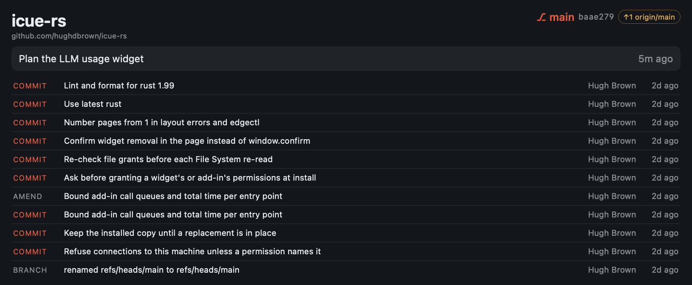

# Git Repository

Branch, sync state with its upstream, and recent activity of one local git repository, updated
live. The header shows the repository name, remote, branch, short commit id and an ahead/behind
badge; below are the latest commit and the most recent reflog entries (commits, amends, merges,
checkouts) with author and age.



*Large (L) slot, showing this repository one commit ahead of `origin/main`.*

The widget reads the text files under `.git/` (`HEAD`, `config`, `packed-refs`, `refs/…` and the
reflogs) through EdgeHost's built-in File System plugin and watches them for changes. It never runs
`git`, never reads the object store, and writes nothing.

## Requirements

- The File System plugin (`widgetbuilder.filesystemprovider:FileSystem:1.0`), built into EdgeHost.
- Read access to your home folder (`<Home>` in `manifest.json`), which `edgectl install` asks you
  to approve.

## Settings

| Setting | Type | Default |
|---|---|---|
| Repository folder | text | empty; set it to the working folder, e.g. `~/projects/icue-rs` (`~/…` and `{Home}/…` both work) |
| Text Color, Accent Color, Background Color | color | `#E8ECF2`, `#F05133`, `#14161B` |

Until the folder is set, or if it is not a repository, the widget shows a message instead.

## Run it

`run-one` uses the defaults, so the folder is empty there. Install the widget and set the folder
on its instance:

```bash
edgectl install examples/widgets/git
edgectl layout add dev.edgehost.git --slot L
edgectl layout set <instance> repoPath '"~/projects/icue-rs"'   # instance id from `edgectl layout show`
```

Or set **Repository folder** in **Configure Widgets…**.

## Files and tests

| Path | Contents |
|---|---|
| `index.html` | Settings and markup |
| `scripts/git-model.js` | Pure parsing of `.git/` files into branch, upstream and activity |
| `scripts/git.js` | Reads and watches the files through the plugin, renders |
| `git.test.mjs` | `node --test examples/widgets/git/` |
| `styles/git.css`, `translation.json`, `resources/icon.svg` | Styles, strings, icon |
