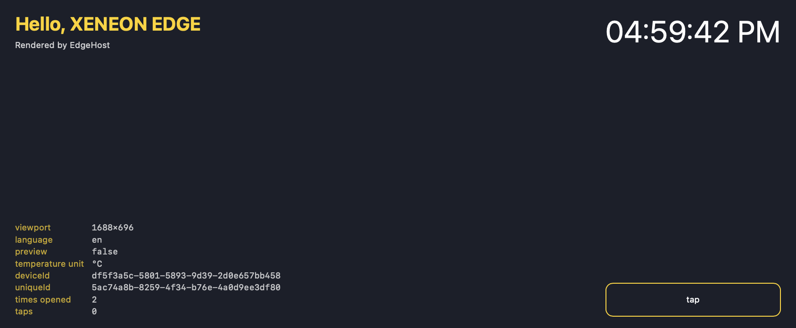

# Hello Edge

EdgeHost's test widget. It shows the iCUE globals EdgeHost injects (viewport, language, preview flag,
temperature unit, device and instance ids), a clock, and a tap counter that persists in
`localStorage`. Start a new widget by copying this folder.



*Large (L) slot, default settings.*

## Settings

| Setting | Type | Default |
|---|---|---|
| Headline | text | from `modules/Greeting.mjs` ("Hello, XENEON EDGE") |
| Show Seconds | switch | on |
| Text Color, Accent Color, Background Color | color | `#FFFFFF`, `#FFD200`, `#1B1F2A` |
| Text Size | slider, 50–200 % | 100 % |

The Headline default is computed by a module listed in `manifest.json` (`modules`), which exercises
EdgeHost's evaluation of JavaScript defaults.

## Run it

```bash
edgectl validate examples/widgets/hello-edge
edgectl run-one examples/widgets/hello-edge --windowed --slot L
```

No plugins, network or file access.

## Files

| Path | Contents |
|---|---|
| `manifest.json` | Widget id, version, `modules` |
| `index.html` | Settings (`x-icue-property` meta tags and groups) and markup |
| `scripts/main.js` | Reads the globals, runs the clock and the tap counter |
| `modules/Greeting.mjs` | Computes the Headline default |
| `styles/main.css`, `translation.json`, `resources/icon.svg` | Styles, strings, icon |
