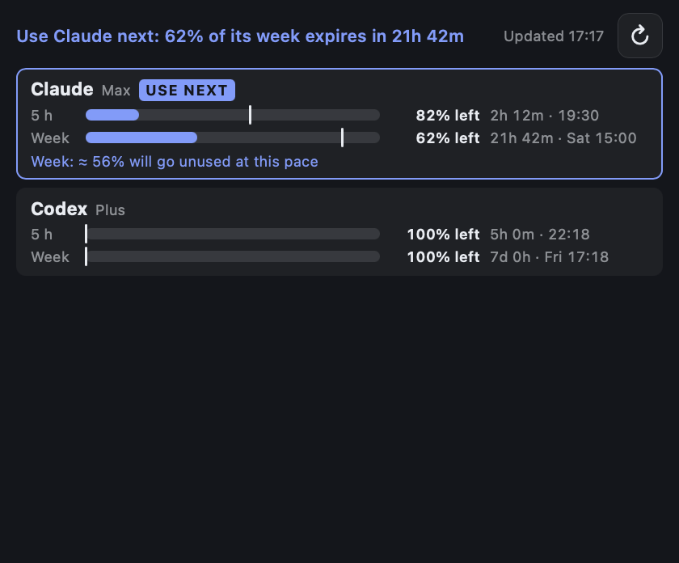

# LLM Usage

How much quota each of your LLM subscriptions has left, when it resets, and whether you are on pace
to use it all before then. The line at the top names the subscription to use next: the one with
the most quota about to expire unused.



*Medium (M) slot with live data. Claude Max is 38% into its week with 87% of the week gone, so the
widget suggests using Claude next; Codex Plus has not been used yet.*

Supported: **Claude** Pro/Max, **Codex** with a ChatGPT plan, the **Gemini** app (AI Pro/Ultra),
**Kimi Code** and **Ollama Cloud**. How each is read and its caveats are in
[`docs/llm-usage.md`](../../../docs/llm-usage.md).

## Reading the widget

- **Bar**: share used. **White tick**: where straight-line use would be now, so it is the "on pace"
  position.
- **Colours**: green is on pace. Amber means ahead of pace: it runs out before the reset at this
  rate. Accent (blue) means behind pace: quota will be left over. Red means used up. Grey means
  not started.
- **Right side**: amount left, then time to the reset and its local time.
- **Note line**: when it runs out, how much will go unused at the current pace, or when a used-up
  subscription comes back.
- **↻**: fetch now. Otherwise EdgeHost polls every `poll_seconds` (default 5 minutes), sharing one
  set of requests among all LLM Usage widgets.
- **Stale** means the last fetch failed and the numbers are older; the reason is shown.
  **Error** means there are no numbers yet.

## Requirements

- EdgeHost's built-in **LlmUsage** plugin (`edgehost.llmusage:LlmUsage:1.0`). It is not an iCUE
  plugin, so the widget does nothing in iCUE.
- A subscriptions file, `llm-usage.toml`, in the EdgeHost data folder, readable only by you.
  Create it with `edgectl llm-usage init`, enable your subscriptions, paste any keys, then check it
  with `edgectl llm-usage`. The widget has no credential settings.

## Settings

| Setting | Type | Default |
|---|---|---|
| Text Color, Accent Color, Background Color | color | `#E8ECF2`, `#7C9CFF`, `#14161B` |

## Run it

```bash
edgectl llm-usage init          # writes ~/Library/Application Support/EdgeHost/llm-usage.toml (0600)
edgectl llm-usage               # what the widget will show
edgectl run-one examples/widgets/llm-usage --windowed --slot M
edgectl install examples/widgets/llm-usage
edgectl layout add dev.edgehost.llm-usage --slot M
```

Designed for **M**. **S** shows one line per subscription with its first two windows. **L** and
**XL** put the cards in two columns.

## Files and tests

| Path | Contents |
|---|---|
| `index.html` | Settings and markup |
| `scripts/llm-model.js` | Pure view model: pace states, run-out and waste projections, the suggestion text |
| `scripts/llm-usage.js` | Plugin wiring and rendering |
| `styles/llm-usage.css` | Layout for S, M, L and XL |
| `llm-usage.test.mjs` | `node --test examples/widgets/llm-usage/` |

The Rust side (fetchers, credentials, pace and ranking) is `crates/llm-usage`, tested with
`cargo test -p llm-usage`.
