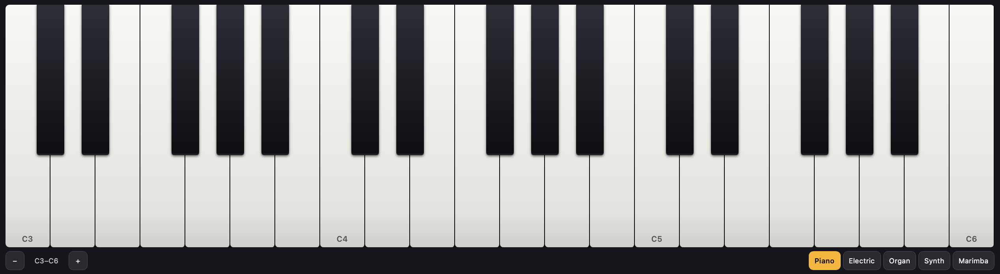

# Piano

A touch piano for the Edge with five synthesized voices: piano, electric piano, organ, synth and
marimba. Several fingers play at once, and a finger slid across the keys glides from note to note.
Sound is made with Web Audio; there are no samples and no network access.



*Extra-large (XL) slot, three octaves from C3, C keys labelled.*

The bar under the keys shifts the keyboard an octave down or up and picks the voice. A computer
keyboard plays too: `z s x d c v g b h n j m ,` for the lower octave and `q 2 w 3 e r 5 t 6 y 7 u i`
for the next.

## Settings

| Setting | Type | Default |
|---|---|---|
| Octaves | 2 or 3 | 3 |
| Starting octave | C2–C5 | C3 |
| Sound | piano, electric, organ, synth, marimba | piano |
| Volume | slider, 0–100 % | 70 % |
| Key labels | none, C keys only, all keys | C keys only |
| Sustain | switch | off |
| Accent Color, Background Color | color | `#FFB300`, `#14161C` |

The octave and sound chosen on the widget are kept in `localStorage` and win until the matching
setting is changed.

## Run it

```bash
edgectl run-one examples/widgets/piano --windowed --slot XL
```

Audio starts on the first touch or click (WebKit requires a user gesture).

## Files and tests

| Path | Contents |
|---|---|
| `index.html` | Settings and markup |
| `scripts/piano.js` | Keyboard layout, voices, multi-touch and glide, computer keyboard |
| `piano.test.mjs` | `node --test examples/widgets/piano/` |
| `styles/piano.css`, `translation.json`, `resources/icon.svg` | Styles, strings, icon |
