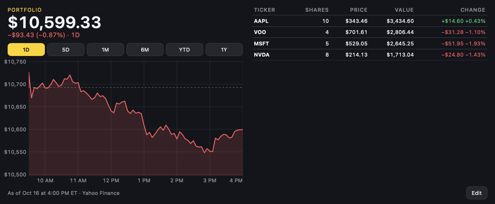

# Stock Portfolio

Value of a US stock portfolio and its change over a chosen period, with a chart and a table of
holdings. Quotes come from Yahoo Finance's chart API. Touch or drag on the chart to read the value
at a point in time; tap **Edit** to change holdings on the widget.



*Large (L) slot, default holdings, 1D period, after the market close.*

## Requirements

Network access to `query1.finance.yahoo.com:443`, declared in `manifest.json` and approved at
install. EdgeHost makes the request for the widget, so the API's missing CORS headers do not matter.

## Settings

| Setting | Type | Default |
|---|---|---|
| Starting holdings | text, `TICKER:shares, …` | `AAPL:10, MSFT:5, NVDA:8, VOO:4` |
| Default period | 1D, 5D, 1M, 6M, YTD, 1Y | 1D |
| Refresh every | slider, 15–600 s | 60 s |
| Text, Accent, Background, Gain and Loss colors | color | `#F2F4F8`, `#FFD200`, `#12151C`, `#2ECC71`, `#FF5C5C` |

Holdings edited on the widget and the selected period are kept in `localStorage`; they win until
the matching setting is changed. **Reset to settings** in the editor discards them.

## Run it

```bash
edgectl run-one examples/widgets/portfolio --windowed --slot L
```

## Files and tests

| Path | Contents |
|---|---|
| `index.html` | Settings, summary, chart, table and holdings editor |
| `scripts/portfolio.js` | Quotes, portfolio series, chart and editor |
| `portfolio.test.mjs` | `node --test examples/widgets/portfolio/` |
| `styles/portfolio.css`, `translation.json`, `resources/icon.svg` | Styles, strings, icon |
