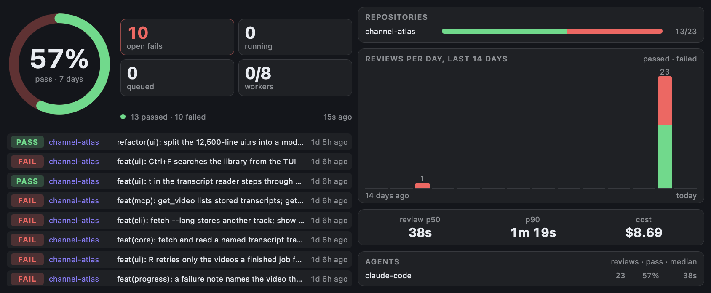

# Roborev

The review queue, pass rate and latest verdicts from [roborev](https://github.com/kenn-io/roborev),
the background code-review daemon. The ring shows the pass rate over the chosen window. The tiles
show open failing reviews (failed and not yet addressed), running and queued jobs, and busy
workers. Below them are the latest reviews, each with its verdict.



*Large (L) slot, last 7 days, live data from a roborev v0.71.0 daemon.*

Each slot shows a different amount:

- **Small**: the ring and the tiles.
- **Medium**: adds the 8 latest reviews.
- **Large**: adds a side column with per-repository pass/fail bars, reviews per day for the last 14
  days (stacked passed and failed), p50/p90 review time, cost over the window, and a per-agent table.
- **Extra-large**: gives the 14-day chart its own column.
- **Portrait**: the same panels, stacked.

## How it gets its data

The widget reads the daemon's JSON API on `127.0.0.1:7373` with `GET` requests only. The
`url` permission in `manifest.json` routes these through EdgeHost, so the daemon doesn't need to
send CORS headers. It never writes anything.

| Request | How often | Used for |
|---|---|---|
| `/api/status` | every 5 s (every 10 s while the daemon is down) | queue counts, workers, paused |
| `/api/health` | every 30 s | health dot and banner |
| `/api/summary?since=7d` | every 30 s, and as soon as the queue counters change | pass rate, open fails, repos, agents, timings, cost |
| `/api/jobs?limit=8&omit_prompt=true` | with the summary | latest reviews |
| `/api/summary?since=1d` … `14d` | every 30 min, L and XL only | reviews per day |
| `/api/repos` | when the Repository setting is a name | name → folder |

`omit_prompt=true` matters: without it, each job carries its full review prompt, and 10 jobs come
to about 640 KB.

## Requirements

- The roborev daemon running on this Mac: `roborev daemon start` (the post-commit hook also starts
  it). It must use the default port, 7373. For another port, change it in `manifest.json` and
  `scripts/roborev.js`.

## Settings

| Group | Setting | Default |
|---|---|---|
| Reviews | Repository: a name as roborev knows it (`roborev repo list`), an absolute folder, or `~/…` | empty (all repositories) |
| Reviews | Window: 24 h, 7 days or 30 days | 7 days |
| Appearance | Text, Accent, Pass, Fail, Background colors | `#E8ECF2`, `#8B7CFF`, `#3DDC84`, `#FF5D5D`, `#14161B` |

## States

- **Daemon not running**: shows "roborev isn't running" and retries every 10 s.
- **Unknown repository**: names the setting it couldn't match, and fetches nothing else.
- **Queue paused or updating**: amber dot and banner.
- **Daemon unhealthy**: red dot and banner listing the failing components.

## Run it

```bash
edgectl run-one examples/widgets/roborev --windowed --slot L
```

## Files and tests

| Path | Contents |
|---|---|
| `index.html` | Settings and markup |
| `scripts/roborev-model.js` | Pure view model: API JSON → texts, states, rows, daily buckets |
| `scripts/roborev.js` | Polling, settings and rendering |
| `roborev.test.mjs`, `fixtures.json` | `node --test examples/widgets/roborev/`; fixtures are trimmed live captures |
| `styles/roborev.css`, `translation.json`, `resources/icon.svg` | Styles (per-slot layouts), strings, icon |
