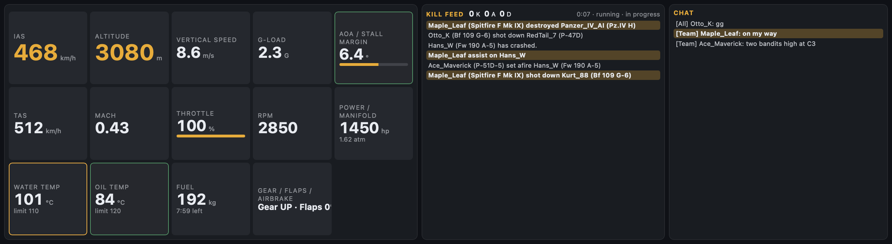

# War Thunder HUD

Flight and vehicle telemetry, the kill feed and chat from War Thunder's own telemetry server (port
8111), on the Edge beside your main monitor. Aircraft get airspeed, altitude, G-load, angle of attack
with stall margin, engine temperatures with time-to-limit, and fuel with time remaining; tanks get
speed, gear, RPM, crew and status flags. Cards turn amber or red as limits approach, and lines that
mention your player name are highlighted.



*Extra-large (XL) slot, aircraft in flight. Recorded against a mock telemetry server with made-up
players. The K/A/D counters are 0 because the history replayed on connect is shown but not counted.*

Smaller slots rearrange and drop panels: Large stacks the kill feed over chat beside the cards,
Medium puts the feed under the cards and hides chat, and Small shows only the key numbers and
warnings.

## Fair play

The widget is read-only. It sends GET requests only to `/state`, `/indicators`, `/hudmsg`,
`/gamechat` and `/mission.json` (enforced in `httpGet()`), never the map endpoints or anything about
other units' positions, and it does not modify the game.

## Requirements

- War Thunder running on this Mac (`localhost`) or on a PC on your network. The telemetry server
  exists only while the game is open.
- Network access to port 8111, declared in `manifest.json` for `localhost` and for any host.

## Settings

| Group | Setting | Default |
|---|---|---|
| Connection | War Thunder PC (host name or IP address) | `localhost` |
| Player | Your player name | empty (no highlighting or K/A/D counts) |
| Player | Units: metric or imperial | metric |
| Player | Poll interval (flight data), 100–1000 ms | 200 ms |
| Player | Show chat | on |
| Thresholds | Low-fuel warning, 1–15 min | 3 min |
| Thresholds | Water / oil temperature limit | 110 °C / 120 °C |
| Thresholds | Critical angle of attack, 8–30° | 15° |
| Appearance | Text, Accent, Background, Warning colors | `#E8ECF2`, `#F2A900`, `#0E1117`, `#FF4D4D` |

## Run it

```bash
edgectl run-one examples/widgets/warthunder-hud --windowed --slot XL
```

Without the game it shows "Waiting for War Thunder on localhost:8111". Field names follow
[lucasvmx/WarThunder-localhost-documentation](https://github.com/lucasvmx/WarThunder-localhost-documentation);
tank fields are community-observed and read defensively.

## Files and tests

| Path | Contents |
|---|---|
| `index.html` | Settings and the card, kill-feed and chat markup |
| `scripts/warthunder-hud.js` | Polling, army detection, estimates, warnings, rendering |
| `warthunder-hud.test.mjs` | `node --test examples/widgets/warthunder-hud/` |
| `styles/warthunder-hud.css`, `translation.json`, `resources/icon.svg` | Styles (per-slot layouts), strings, icon |
